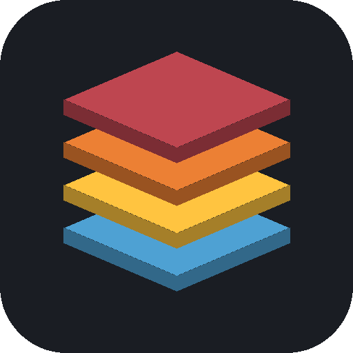

# G-code viewer

<b>English</b>

Mainsail-style 3D G-code viewer for Stellio. Opens from the **Plugins** menu in the left bar.

- 3D view (orbit, pan, zoom, Iso/Top/Front/Side views)
- Layer range sliders and a moves slider with playback (×0.25 to ×16)
- Colors by feature type, layer, speed or flow
- Travel moves, retractions, bed and axes toggles; bed size taken from your printers
- Stats: layers, height, area, filament (m ≈ g), estimated time
- Read-only: needs only the `ui` and `api:read` permissions, no network

Install: Plugins › Catalogue › G-code viewer › Install, then enable it.

License: GNU AGPL v3.

<b>Français</b>

Visionneuse 3D de G-code façon Mainsail pour Stellio. S'ouvre depuis le menu **Plugins** de la barre de gauche.

- Vue 3D (rotation, déplacement, zoom, vues Iso/Dessus/Face/Côté)
- Curseurs de plage de couches et curseur de mouvements avec lecture (×0,25 à ×16)
- Couleurs par type d'extrusion, couche, vitesse ou débit
- Déplacements, rétractions, plateau et axes activables ; taille du plateau reprise de vos imprimantes
- Statistiques : couches, hauteur, zone, filament (m ≈ g), durée estimée
- Lecture seule : uniquement les permissions `ui` et `api:read`, aucun accès réseau

Installation : Plugins › Catalogue › G-code viewer › Installer, puis activez-le.

Licence : GNU AGPL v3.

<b>Deutsch</b>

3D-G-Code-Viewer im Mainsail-Stil für Stellio. Wird über das Menü **Plugins** in der linken Leiste geöffnet.

- 3D-Ansicht (Drehen, Verschieben, Zoom, Ansichten Iso/Oben/Vorne/Seite)
- Regler für den Schichtbereich und für Bewegungen mit Wiedergabe (×0,25 bis ×16)
- Farben nach Strukturtyp, Schicht, Geschwindigkeit oder Fluss
- Leerfahrten, Retractions, Druckbett und Achsen schaltbar; Druckbettgröße aus Ihren Druckern
- Statistiken: Schichten, Höhe, Bereich, Filament (m ≈ g), geschätzte Dauer
- Nur lesend: nur die Berechtigungen `ui` und `api:read`, kein Netzwerk

Installation: Plugins › Katalog › G-code viewer › Installieren, dann aktivieren.

Lizenz: GNU AGPL v3.

<b>Español</b>

Visor 3D de G-code al estilo Mainsail para Stellio. Se abre desde el menú **Plugins** de la barra izquierda.

- Vista 3D (rotar, desplazar, zoom, vistas Iso/Superior/Frontal/Lateral)
- Controles de rango de capas y de movimientos con reproducción (×0,25 a ×16)
- Colores por tipo de estructura, capa, velocidad o flujo
- Desplazamientos, retracciones, cama y ejes activables; tamaño de cama tomado de sus impresoras
- Estadísticas: capas, altura, área, filamento (m ≈ g), duración estimada
- Solo lectura: únicamente los permisos `ui` y `api:read`, sin red

Instalación: Plugins › Catálogo › G-code viewer › Instalar y actívelo.

Licencia: GNU AGPL v3.

<b>Português</b>

Visualizador 3D de G-code ao estilo Mainsail para o Stellio. Abre-se a partir do menu **Plugins** da barra esquerda.

- Vista 3D (rodar, deslocar, zoom, vistas Iso/Topo/Frente/Lado)
- Controlos do intervalo de camadas e dos movimentos com reprodução (×0,25 a ×16)
- Cores por tipo de estrutura, camada, velocidade ou fluxo
- Deslocações, retrações, mesa e eixos ativáveis; tamanho da mesa obtido das suas impressoras
- Estatísticas: camadas, altura, área, filamento (m ≈ g), duração estimada
- Só leitura: apenas as permissões `ui` e `api:read`, sem rede

Instalação: Plugins › Catálogo › G-code viewer › Instalar e ative-o.

Licença: GNU AGPL v3.

<b>Italiano</b>

Visualizzatore 3D di G-code in stile Mainsail per Stellio. Si apre dal menu **Plugins** della barra a sinistra.

- Vista 3D (rotazione, spostamento, zoom, viste Iso/Alto/Fronte/Lato)
- Cursori per l'intervallo di strati e per i movimenti con riproduzione (×0,25 – ×16)
- Colori per tipo di struttura, strato, velocità o flusso
- Spostamenti, retrazioni, piatto e assi attivabili; dimensione del piatto presa dalle vostre stampanti
- Statistiche: strati, altezza, area, filamento (m ≈ g), durata stimata
- Sola lettura: solo i permessi `ui` e `api:read`, nessuna rete

Installazione: Plugins › Catalogo › G-code viewer › Installa, poi attivatelo.

Licenza: GNU AGPL v3.

<b>中文</b>

适用于 Stellio 的 Mainsail 风格 3D G-code 查看器。从左侧栏的 **Plugins** 菜单打开。

- 3D 视图（旋转、平移、缩放，Iso/顶视/前视/侧视）
- 层范围滑块和带播放的移动滑块（×0.25 至 ×16）
- 按结构类型、层、速度或流量着色
- 可切换空走、回抽、热床和坐标轴；热床尺寸取自您的打印机
- 统计：层数、高度、范围、耗材（m ≈ g）、预计时间
- 只读：仅需 `ui` 和 `api:read` 权限，无网络访问

安装：Plugins › 目录 › G-code viewer › 安装，然后启用。

许可证：GNU AGPL v3。

<b>日本語</b>

Stellio 用の Mainsail 風 3D G-code ビューア。左バーの **Plugins** メニューから開きます。

- 3D 表示（回転・移動・ズーム、Iso/上面/正面/側面ビュー）
- レイヤー範囲スライダーと、再生付きの移動スライダー（×0.25〜×16）
- 構造タイプ・レイヤー・速度・流量による色分け
- 非押出し移動・リトラクション・ベッド・軸の切り替え。ベッドサイズはプリンター設定から取得
- 統計：レイヤー数、高さ、範囲、フィラメント（m ≈ g）、推定時間
- 読み取り専用：必要な権限は `ui` と `api:read` のみ、ネットワークなし

インストール：Plugins › カタログ › G-code viewer › インストール後、有効化します。

ライセンス：GNU AGPL v3。

